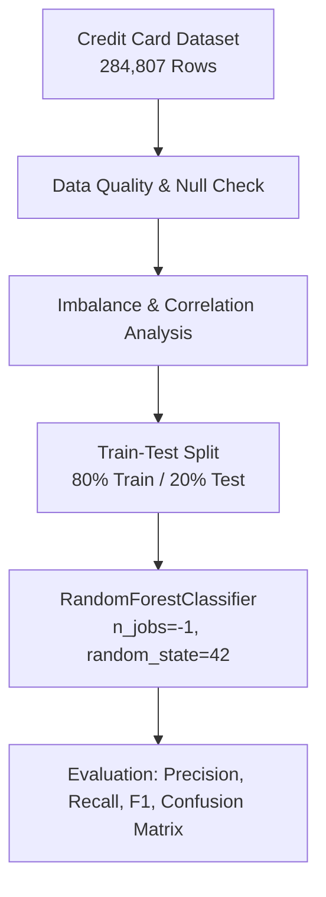

# 💳 Credit Card Fraud Detection with Random Forest

[](https://www.python.org/)
[](https://jupyter.org/)
[](https://scikit-learn.org/)
[](LICENSE)

A machine learning project tackling extreme real-world class imbalance in financial transaction data using **Random Forest Classification**. The model detects fraudulent credit card transactions among hundreds of thousands of legitimate operations with high precision and recall.

---

## 📌 Problem Statement

Financial fraud detection is an inherently imbalanced problem: less than **0.2%** of all transactions are fraudulent. Traditional accuracy metrics are misleading in this scenario—a naive classifier predicting "not fraud" for every instance would achieve 99.83% accuracy while failing to detect a single actual fraud event.

This project implements an end-to-end data science pipeline with exploratory analysis, correlation analysis, and a `RandomForestClassifier` tuned for anomaly detection.

---

## 📊 Dataset Profile

- **Source:** [Kaggle Credit Card Fraud Detection Dataset](https://www.kaggle.com/datasets/mlg-ulb/creditcardfraud)
- **Total Transactions:** 284,807
- **Class Breakdown:**
  - **Legitimate (Class 0):** 284,315 (99.83%)
  - **Fraudulent (Class 1):** 492 (0.17%)
- **Features:** 30 numerical features (`V1` to `V28` transformed via PCA for privacy, plus transaction `Time` and `Amount`).

---

## 🔬 Authentic Baseline Model Performance

Evaluated on an 80/20 train-test split (56,962 test transactions) using `RandomForestClassifier(n_jobs=-1, random_state=42)`:

| Metric | Score | Interpretation |
| :--- | :--- | :--- |
| **Accuracy** | **99.96%** | Overall correct classifications across all transactions |
| **Precision** | **94.12%** | Out of 85 transactions flagged as fraud, 80 were genuine fraud |
| **Recall** | **81.63%** | The model caught 80 out of 98 total fraud events in the test set |
| **F1-Score** | **0.8743** | Harmonic mean balancing precision and recall |

### Confusion Matrix
```
                    Predicted Normal    Predicted Fraud
Actual Normal            56,859                 5
Actual Fraud                 18                80
```
- **False Positives (5):** Minimal friction for legitimate cardholders.
- **False Negatives (18):** Low miss rate given the extreme imbalance without oversampling.

---

## 🏗️ Methodology & Workflow



---

## 🚀 Getting Started

### 1. Clone the Repository
```bash
git clone https://github.com/usha1101/credit_card_fraud_detect_randomforests.git
cd credit_card_fraud_detect_randomforests
```

### 2. Set Up Virtual Environment
```bash
python -m venv venv
# On Windows:
.\venv\Scripts\activate
# On Linux/macOS:
source venv/bin/activate
```

### 3. Install Requirements
```bash
pip install -r requirements.txt
```

### 4. Download Dataset
1. Download `creditcard.csv` from [Kaggle](https://www.kaggle.com/datasets/mlg-ulb/creditcardfraud).
2. Place `creditcard.csv` in the project root directory or inside a `data/` folder.

### 5. Launch Jupyter Notebook
```bash
jupyter notebook Credit_card_fraud_detection_randomforests.ipynb
```

---

## 📂 Repository Contents

```text
credit_card_fraud_detect_randomforests/
├── .gitignore                                      # Prevents accidental upload of 150MB CSV
├── Credit_card_fraud_detection_randomforests.ipynb # Full analysis & modeling notebook
├── README.md                                       # Project documentation & metrics
└── requirements.txt                                # Environment dependencies
```

---

## 👩‍💻 Author

**Ushashree M**  
- B.Tech Artificial Intelligence & Data Science, Reva University  
- GitHub: [@usha1101](https://github.com/usha1101)  

---

## 📄 License

This project is licensed under the [MIT License](LICENSE).
